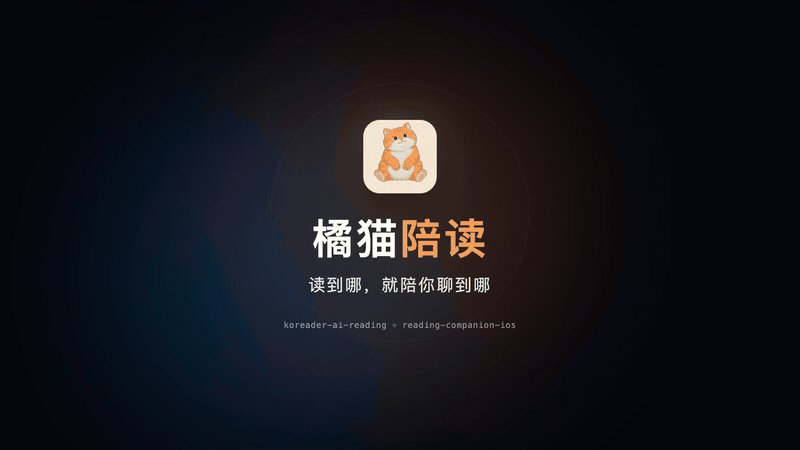

# KOReader AI Reading

**English** | [简体中文](README.zh-CN.md)

A customized KOReader setup for Kindle: open straight into the WeRead bookshelf, a cleaner top status bar, and a bridge that sends the current page to an iPhone AI reading companion.

> This repository contains the **Kindle/KOReader side only**. The iPhone app is a separate project and is not included here.

## Features

- **WeRead shelf as home**: KOReader opens the WeRead bookshelf automatically.
- **Better bookshelf menu**: adds `Settings` and `Exit KOReader` to the shelf menu.
- **Direct reading**: tapping a cached/downloaded book opens the reader instead of the detail page.
- **Top status bar**: auto refresh, clock, page number, total pages, battery percentage, and Wi-Fi state.
- **AI context bridge**: sends book, chapter, page, progress, and current-page text to the iPhone over local HTTP.
- **LAN discovery**: broadcasts on UDP `8791` to find the phone when switching between hotspot and home Wi-Fi.
- **Default Alt Status Bar** for new books, with title/author hidden to leave room for page info.
- **Auto sleep preserved**: releases stale WeRead standby guards so Kindle can still suspend normally.

## Demo

<a href="docs/media/promo-zh.mp4"></a>

[Watch the 45-second promo (MP4)](docs/media/promo-zh.mp4)


## Tested device

| Item | Value |
|---|---|
| Kindle | **Kindle 7th Generation (KT2, 2014, 600×800)** |
| Firmware | **5.12.2.2** |
| KOReader | **v2026.07.1** |
| WeRead plugin | **v1.7.0** |

Only this combination has been tested end-to-end. Other Kindle models or KOReader versions may work, but the patches are version-sensitive and are not guaranteed.

## Credentials

The Kindle side needs **no cloud API key**. The iPhone companion app needs:

- **OpenCode Go API key** for AI replies;
- optional **Tencent Cloud SecretId / SecretKey** for Chinese one-sentence ASR (`一句话识别`, 5,000 free calls/month).

Setup links and details are in the app repository:
https://github.com/successcw/reading-companion-ios#what-you-need-to-apply-for

The `token` in `config.lua` is only a local shared secret between Kindle and the app; it is not a cloud key.

## Requirements

- A jailbroken Kindle with KOReader installed.
- KOReader `v2026.07.1`.
- `weread.koplugin` `v1.7.0` if you want WeRead integration.
- USB access to the Kindle `koreader/` directory.

## Install

```bash
# macOS
./install.sh /Volumes/Kindle/koreader

# Linux
./install.sh /media/$USER/Kindle/koreader
```

The script will:

1. Back up `weread.koplugin` and `creoptions.lua` to `koreader-ai-reading-backup-<timestamp>/`.
2. Copy the three plugins.
3. Apply the `weread.koplugin 1.7.0` patch.
4. Enable the Alt Status Bar by default.
5. Keep your existing `ai_bridge/config.lua`.

Then edit:

```text
koreader/plugins/ai_bridge.koplugin/config.lua
```

```lua
return {
    url = "http://172.20.10.1:8790/context",
    token = "change-me",
    max_chars = 4000,
}
```

- `url`: the address shown on the iPhone app; usually auto-filled by LAN discovery.
- `token`: must match the token in the app settings.
- `max_chars`: maximum current-page text per request.

Restart KOReader, open a book, and turn a page.

## Privacy

- The plugin sends only the current page text, book title, chapter, page number, and progress to the URL you configure.
- No books, personal images, API keys, or account credentials are included in this repository.
- `config.lua` is ignored by Git; use `config.example.lua` as a template.
- The receiving service (the iPhone app) may send the text to an LLM. Review your own privacy and copyright requirements.

## Known limitations

- **iPhone hotspot broadcasting**: iOS does not keep the Personal Hotspot discoverable all the time. Kindle can connect only while the hotspot is broadcasting.
- **App must stay active**: iOS may suspend the app's local HTTP server when the app is in the background.
- Current-page extraction depends on the document type; some PDFs/scanned books may return empty text.
- Patches target KOReader `2026.07.1` and weread `1.7.0`; upgrades may require regenerating them.

## License

- Our plugins and scripts: **MIT** (see `LICENSE`).
- `patches/weread-1.7.0.patch` is a derivative of the AGPL-3.0 `weread.koplugin`; it is distributed under AGPL-3.0. See `THIRD_PARTY.md`.
- KOReader itself is GPL-3.0; no KOReader binaries are included.

## Credits

- [KOReader](https://github.com/koreader/koreader)
- [weread.koplugin](https://github.com/finlater/weread.koplugin)
- KindleModding / KPM community
