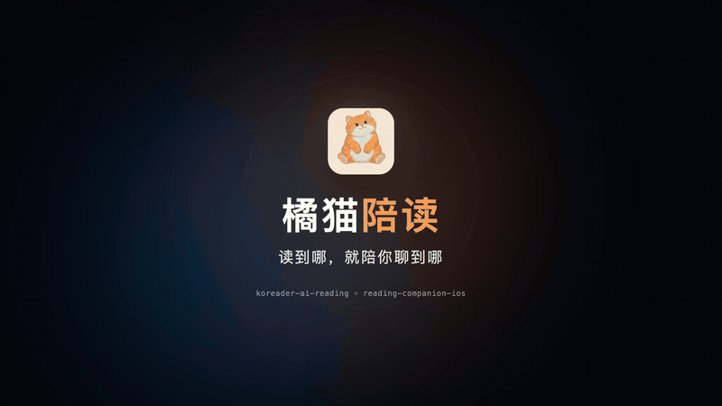

# KOReader AI Reading

[English](README.md) | **简体中文**

把 Kindle 上的 KOReader 改成「打开就是微信读书书架」的阅读器，并把当前页正文/进度上报给 iPhone 上的 AI 陪读 App。

> 本仓库只包含 **Kindle / KOReader 侧**。iPhone App 是独立项目，不在这里。

## 功能

- **微信读书书架作为首页**：KOReader 启动后自动打开书架。
- **书架菜单增强**：右上角菜单增加 `Settings` 和 `Exit KOReader`。
- **点书直接阅读**：已缓存/已下载的书，点击直接进正文，不再经过详情页。
- **顶部状态栏**：自动刷新、时间、页码、总页数、电池百分比、WiFi 状态。
- **AI 上下文上报**：翻页时把书名、章节、页码、进度、当前页正文通过本地 HTTP 发给 iPhone；
- **局域网发现**：通过 UDP `8791` 自动寻找手机，热点/家庭 WiFi 切换后不用手改地址。
- **默认顶部状态栏**：新书默认开启 Alt Status Bar，并隐藏书名/作者给页码留空间。
- **保留自动锁屏**：修复微信读书后台任务遗留的防休眠标记，避免 Kindle 一直不睡。

## 宣传视频

<a href="docs/media/promo-zh.mp4"></a>

[观看 45 秒宣传片（MP4）](docs/media/promo-zh.mp4)


## 已测试设备

| 项目 | 值 |
|---|---|
| Kindle | **Kindle 第 7 代（KT2，2014，600×800）** |
| 固件 | **5.12.2.2** |
| KOReader | **v2026.07.1** |
| 微信读书插件 | **v1.7.0** |

目前只在这个组合上完整跑通。其他 Kindle 型号或 KOReader 版本可能可用，但补丁对版本敏感，不保证兼容。

## 需要哪些 Key

Kindle 侧本身**不需要云服务 Key**。iPhone App 需要：

- **OpenCode Go API Key**：用于 AI 回答；
- 可选的 **腾讯云 SecretId / SecretKey**：用于中文「一句话识别」，每月 5,000 次免费。

申请入口和详细步骤见 App 仓库：
https://github.com/successcw/reading-companion-ios#需要申请哪些-key

`config.lua` 里的 `token` 只是 Kindle 和 App 之间的本地共享密钥，不是云服务 Key。

## 前置条件

- 已越狱的 Kindle，且已安装 KOReader；
- KOReader `v2026.07.1`；
- 需要微信读书功能时，安装 `weread.koplugin` `v1.7.0`；
- 能通过 USB 访问 Kindle 的 `koreader/` 目录。

## 安装

```bash
# macOS
./install.sh /Volumes/Kindle/koreader

# Linux
./install.sh /media/$USER/Kindle/koreader
```

脚本会：

1. 备份 `weread.koplugin` 和 `creoptions.lua` 到 `koreader-ai-reading-backup-<时间>/`；
2. 复制 3 个插件；
3. 给 `weread.koplugin 1.7.0` 打补丁；
4. 把新书默认 Alt Status Bar 打开；
5. 保留你已有的 `ai_bridge/config.lua`。

然后编辑：

```text
koreader/plugins/ai_bridge.koplugin/config.lua
```

```lua
return {
    url = "http://172.20.10.1:8790/context",
    token = "change-me",
    max_chars = 4000,
}
```

- `url`：兜底地址，填 iPhone App 首页显示的地址；通常会被局域网发现自动更新；
- `discovery_broadcast`：可选，填当前网段广播地址（如 `192.168.1.255`），用于路由器丢弃 `255.255.255.255` 的情况。
- `token`：要和 App 设置里的 Token 一致；
- `max_chars`：单次上报正文上限。

改完重启 KOReader，打开书翻一页。

## 隐私

- 插件只把当前页正文、书名、章节、页码、进度发到你配置的地址；
- 仓库不包含书、个人图片、API key、账号凭据；
- `config.lua` 已被 Git 忽略，使用 `config.example.lua` 作为模板；
- 接收端（iPhone App）可能会把正文发给 LLM，请自行确认隐私和版权要求。

## 已知限制

- **iPhone 热点不会持续广播**：iOS 只在热点广播时才能被 Kindle 发现；
- **App 要尽量保持前台**：iOS 可能在后台挂起本地 HTTP 服务；
- 当前页正文提取依赖文档类型，部分 PDF/扫描书可能取不到；
- 补丁针对 KOReader `2026.07.1` 和 weread `1.7.0`，升级后可能需要重新生成。

## 许可证

- 本仓库自有插件与脚本：**MIT**（见 `LICENSE`）；
- `patches/weread-1.7.0.patch` 基于 AGPL-3.0 的 `weread.koplugin`，按 AGPL-3.0 分发，见 `THIRD_PARTY.md`；
- KOReader 本体为 GPL-3.0，本仓库不包含其二进制。

## 致谢

- [KOReader](https://github.com/koreader/koreader)
- [weread.koplugin](https://github.com/finlater/weread.koplugin)
- KindleModding / KPM 社区
